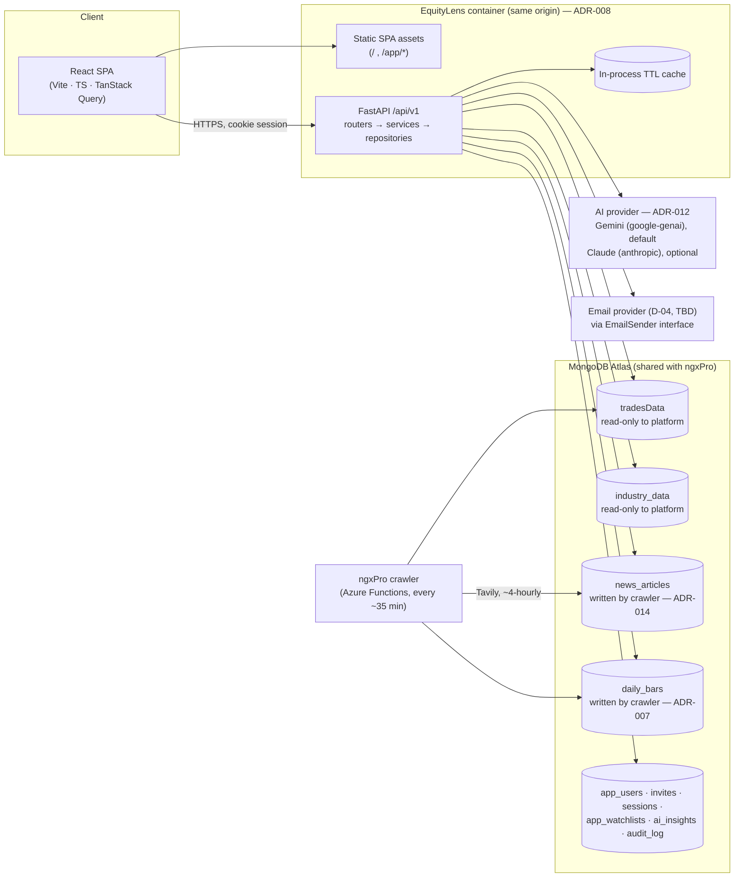

# 03 — Target Architecture

> Status: **Accepted; Phase 1 backend built** (2026-10-26) · Decisions referenced as ADR-xxx live in [`04-technical-decisions.md`](04-technical-decisions.md)

## 1. System overview



### Principles

1. **Data stays put.** The crawler owns `tradesData`, `daily_bars` and `news_articles`. The platform reads them and writes only its own collections.
2. **Compute once, serve many.** Daily bars, indicators, and AI insights are deterministic per (symbol, day), so cache them aggressively. Data changes at most every ~35 minutes.
3. **Thin client for maths, rich client for interaction.** Indicators and signals are computed server-side (one tested implementation). The browser renders, zooms, and toggles without round-trips.
4. **Same origin.** The SPA and API are served from one origin. That gives us cookie sessions without CORS or third-party-cookie problems.
5. **The OpenAPI contract is the source of truth.** The frontend's TypeScript types are generated from it.

---

## 2. Repository layout

```text
platformApp/
├── backend/                  FastAPI service (new)
├── frontend/                 React SPA (new)
├── design/                   Design tokens (tokens.css) + visual reference (preview.html)
├── brand/                    Logo SVGs + PNG exports
├── docs/                     This documentation set
├── streamlitApp/             Frozen copy of the legacy Streamlit app (reference + rollback)
├── CHANGELOG.md
└── README.md
```

The legacy files at the `platformApp/` root (`app.py`, `views/`, …) stay in place until cutover (Phase 5), because production may deploy from that path. They are removed in Phase 5 once `streamlitApp/` (or the new app) is the deployed target.

---

## 3. Backend (FastAPI)

### 3.1 Module layout

```text
backend/
├── pyproject.toml            uv-managed; ruff, mypy, pytest config
├── app/
│   ├── main.py               app factory, middleware, router mounting, static SPA mount
│   ├── core/
│   │   ├── config.py         pydantic-settings (env-driven, validated at boot)
│   │   ├── security.py       argon2id hashing (+ legacy PBKDF2 verify), session tokens, CSRF
│   │   ├── errors.py         RFC 9457 problem+json handlers
│   │   ├── cache.py          TTL cache helpers (cachetools), cache keys
│   │   └── logging.py        structured JSON logs, request IDs
│   ├── db/mongo.py           PyMongo client lifecycle, index creation at startup
│   ├── domain/               ← PURE, framework-free, ported from streamlitApp with tests
│   │   ├── indicators.py     SMA/EMA/RSI/MACD/Bollinger (project rules enforced)
│   │   ├── signals.py        strategies + STRATEGIES registry
│   │   └── similarity.py     peer scoring (from views/deep_dive.py::_find_similar)
│   ├── repositories/         all MongoDB access; one module per collection family
│   │   ├── bars_repo.py      daily bars per symbol, per day (snapshot) and per range: daily_bars, with
│   │   │                     a tradesData fallback before its first trade date (M0-safe pipelines)
│   │   ├── industry_repo.py  company directory and profiles
│   │   ├── news_repo.py      news_articles reads (symbol hits, sector fill-ins, top stories)
│   │   ├── users_repo.py · invites_repo.py · sessions_repo.py · watchlist_repo.py · insights_repo.py
│   ├── services/             orchestration: caching, composition, quotas
│   │   ├── market_service.py · stock_service.py · news_service.py · insight_service.py
│   │   ├── auth_service.py · invite_service.py · audit_service.py
│   │   ├── email/            EmailSender interface + resend.py (default) · acs.py (planned) · console.py (dev) (D-04)
│   │   └── ai/               provider interface + gemini.py, anthropic.py adapters (ADR-012)
│   ├── api/v1/               routers (HTTP only, no business logic)
│   │   ├── auth.py · invites.py · market.py · stocks.py · news.py · insights.py · watchlist.py · admin.py · health.py
│   └── schemas/              pydantic request/response models
└── tests/                    unit (domain, services with mocks) + API (httpx TestClient)
```

**Layer rules** (carried over from the Streamlit README's layer discipline):

- `api/` → `services/` → `repositories/` and `domain/`. Never the other direction.
- `domain/` has no I/O, no FastAPI, no Mongo. Pure pandas/numpy in, pure data out.
- Only `repositories/` imports PyMongo.
- Only the adapters in `services/ai/` import an AI SDK (`google-genai`, `anthropic`). No LangChain.

### 3.2 Concurrency model (ADR-003)

Route handlers are plain `def`, so FastAPI runs them in its threadpool, and they use the **synchronous PyMongo client**. Pandas work is CPU-bound and sync anyway, and this lets us port the proven loader pipelines and their tests with minimal change. We revisit (PyMongo `AsyncMongoClient`) only if load testing shows threadpool saturation.

### 3.3 API surface (v1)

All under `/api/v1`. JSON. Dates are ISO-8601 in WAT (`+01:00`). Money is raw numbers in NGN (formatting is the client's job). Errors use `application/problem+json`.

| Method & path | Purpose | Auth | Cache |
| --- | --- | --- | --- |
| `POST /access-requests` | "Request an invite" from the landing page (email, name, optional note) | public, rate-limited | — |
| `POST /invites/lookup` · `POST /invites/accept` | Validate an invite; accept it by setting a name and password → account + session. The token goes in the JSON body, never the URL (ASVS 14.2.1); email links carry it in the fragment (`/invite#token=…`, likewise `/reset#token=…`, `/verify#token=…`) | public, rate-limited | — |
| `POST /auth/signup` · `POST /auth/verify-email` | Self-serve sign-up and verification. **Disabled while `SIGNUP_MODE=invite`** (ADR-013) | public, rate-limited | — |
| `POST /auth/login` | Email *or* legacy username + password → session cookie | public, rate-limited | — |
| `GET /auth/csrf` | CSRF token (also set as the `el_csrf` cookie, `__Host-el_csrf` outside local; the session cookie is likewise `__Host-el_session`); send it back as `X-CSRF-Token` on every POST/PUT/PATCH/DELETE | public | — |
| `POST /auth/logout` · `POST /auth/logout-all` | Revoke this session · every session | user | — |
| `POST /auth/password/forgot` · `/reset` | Reset flow (always 202 to avoid account enumeration) | public, rate-limited | — |
| `GET /auth/me` · `PATCH /auth/me` · `DELETE /auth/me` | Profile, theme (US-6.2), change email or password, delete account | user | — |
| `GET /market/status` | Latest `fetched_at`, last trading date, is-market-open, data age | public | 60 s |
| `GET /market/snapshot?date=` | Stats, breadth, gainers/losers/most-traded, full price table | user | 5 min |
| `GET /market/range?start=&end=` | Cumulative per-symbol period performance | user | 5 min |
| `GET /market/sectors?date=` or `?start=&end=` | Sector aggregates | user | 5 min |
| `GET /strategies` | Signal strategies (slug, label, description, warm-up days) | user | — |
| `GET /stocks` | Symbol directory: symbol, company name, sector (powers search) | user | 1 h |
| `GET /stocks/{symbol}` | Profile + latest quote | user | 5 min |
| `GET /stocks/{symbol}/bars?start=&end=` | Daily OHLCV | user | 5 min |
| `GET /stocks/{symbol}/indicators?start=&end=&set=sma50,ema12,rsi14,macd,bb20` | Series computed on **full history**, then sliced | user | 5 min |
| `GET /stocks/{symbol}/signals?strategy=&start=&end=` | Buy/sell events (computed on full history, sliced) | user | 5 min |
| `GET /stocks/{symbol}/similar?start=&end=&sort=` | Peer list with component scores | user | 10 min |
| `POST /stocks/{symbol}/insights` `{strategy,start,end}` | AI signal interpretation (quota-checked; may include ≤ 5 headlines, US-9.5) | user | shared, per (symbol, strategy, range, data-date, newest-headline-id) |
| `GET /stocks/{symbol}/news?days=30&limit=5&sort=recent\|importance` | `{mentions: [...], sector: [...]}`: headline, source, published_at, `published_at_estimated`, snippet (≤ 200 chars, plain text), url | user | 10 min |
| `GET /stocks/{symbol}/news/markers?start=&end=` | Per-day article counts and headlines for chart markers (US-9.2) | user | 10 min |
| `GET /news/top?hours=48&limit=5&sector=` | Top stories by importance, with tagged symbols (US-9.3) | user | 10 min |
| `GET /news?symbols=&watchlist=&sectors=&subsectors=&topics=&scope=&regulators=&content_types=&sources=&from=&to=&title_only=&q=&sort=&cursor=` | **News page** (US-9.8): filtered, cursor-paginated list; the first page adds `facets` (counts per filter value, each applying every *other* filter so a second value in the same filter shows what it adds) and `total`. Untagged (pre-v2) articles count as `news` for `content_types` | user | 10 min |
| `GET /me/watchlist/news?days=7` | News mentioning any watchlist stock (US-9.4) | user | 10 min |
| `POST /news/{id}/feedback` `{symbol, reason}` | Report a mis-tagged article (US-9.7, v1.1) | user | — |
| `GET/PUT/DELETE /me/watchlist[/{symbol}]` | Watchlist CRUD | user | — |
| `GET /admin/users` · `PATCH /admin/users/{id}` | Search, role, activate/deactivate | admin | — |
| `GET/POST /admin/invites` · `POST /admin/invites/{id}/resend` · `DELETE /admin/invites/{id}` | Send, list, resend, revoke invites | admin | — |
| `GET /admin/access-requests` · `POST /admin/access-requests/{id}/approve` · `/decline` | Review "request an invite" submissions; approving sends an invite | admin | — |
| `GET /admin/usage` | AI calls per day, sign-ups, active users | admin | — |
| `GET /admin/audit-log?from=&to=&category=&actor=&target=&outcome=&q=&cursor=` | Filtered, cursor-paginated audit events (newest first) | admin | — |
| `GET /admin/audit-log/{id}` · `GET /admin/audit-log/export.csv?…` | Event detail; CSV export of the current filter (the export is itself audited) | admin | — |
| `GET /healthz` · `GET /readyz` | Liveness; readiness (Mongo ping) | public | — |

The response shapes are defined as pydantic models in `schemas/` and are reviewed in Phase 1 before frontend work starts.

### 3.4 Data model (platform-owned collections)

| Collection | Key fields | Indexes |
| --- | --- | --- |
| `app_users` (existing, shared with Streamlit until cutover, D-17) | `email` (lowercased), `email_verified_at`, `pending_email`, `username` (legacy; = email for new users), `display_name`, `password_argon2` + `hash_scheme`, `password_hash` + `salt` (legacy PBKDF2, kept in step until cutover), `role`, `is_active`, `source` (invite\|cli\|signup), `created_at`, `last_login_at` | unique `email` (partial: string); the Streamlit app's unique `username` |
| `sessions` | `token_hash`, `user_id`, `created_at`, `expires_at`, `ip`, `user_agent` | unique `token_hash`; TTL on `expires_at` |
| `email_tokens` | `token_hash`, `user_id`, `purpose` (verify\|reset), `expires_at`, `used_at` | TTL on `expires_at` |
| `invites` | `email`, `token_hash`, `role`, `invited_by`, `status` (pending\|accepted\|revoked\|expired), `expires_at` (7 days), `accepted_at`, `resend_count` | unique `token_hash`; `email`; `status` |
| `access_requests` | `email`, `name`, `note`, `status` (new\|approved\|declined), `created_at`, `reviewed_by` | unique `email` (pending only); `status` |
| `app_watchlists` (D-19; `watchlists` is the Telegram bot's) | `user_id`, `symbols[]`, `updated_at` | unique `user_id` |
| `ai_insights` | `cache_key`, `symbol`, `strategy`, `range`, `data_as_of`, `model`, `output` (structured), `tokens_in/out`, `created_at` | unique `cache_key`; TTL 7 days |
| `ai_usage` | `user_id`, `date` (WAT), `count` | unique (`user_id`,`date`); TTL 90 days |
| `audit_log` (append-only) | `at`, `actor` {`id`, `email`, `kind`: user\|admin\|system\|anonymous}, `action` (e.g. `invite.sent`, `auth.login_failed`), `category`, `target` {`type`, `id`, `label`}, `outcome` (success\|failure), `ip`, `user_agent`, `request_id`, `changes` {before, after}, `flags` (e.g. `suspicious`) | `at` desc; (`actor.id`, `at`); (`target.id`, `at`); (`category`, `at`); TTL 365 days |
| `daily_bars` (ADR-007, **written by the crawler**) | `symbol`, `trade_date` (NGX session, `YYYY-MM-DD`), `open`, `high`, `low`, `close`, `prev_close`, `change`, `pct_change`, `volume`, `value`, `trades`, `sector`, `updated_at` | unique (`symbol`,`trade_date`); `trade_date` |

`tradesData`, `daily_bars`, `industry_data` and `news_articles` are **read-only** to the platform. `news_articles` (crawler-owned, ADR-014) has `title`, `url` (unique), `source`, `content` (≤ 1,000 chars, never shown in full), `published_at`, `symbols[]`, `sector`, `importance_score`, `embedding` (384-dim, nullable), `fetched_at`, and a 90-day TTL. **Tag schema v2** (D-15, [10 §3](10-news-tagging.md#3-tag-schema-v2)) adds `symbol_mentions[]` (title vs body), `primary_symbol`, `sectors[]`, `subsectors[]`, `topics[]`, `scope`, `regulators[]`, `content_type`, `geography`, `source_tier`, `published_at_estimated`, `tagger_version`, and `tagged_at`, with filter indexes per [10 §7](10-news-tagging.md#7-rollout-phase-1-crawler-work). Facet counts use one `$match` → `$facet` aggregation over a small (≤ 90-day) collection, which is safe on M0. The platform adds one collection of its own, `news_feedback` (`article_id`, `symbol`, `user_id`, `reason`, `at`; unique per user+article+symbol), for US-9.7.

### 3.5 Caching

- **In-process TTL caches** (`cachetools.TTLCache`) per service function, with TTLs mirroring the current `st.cache_data` values (5 min market, 10 min bounds/sectors, 1 h directory).
- **HTTP caching**: `Cache-Control: private, max-age=60` plus `ETag` derived from the latest `fetched_at`. Repeat loads return `304`.
- **AI insights** are cached in Mongo (`ai_insights`) and shared across users. The key includes `data_as_of`, so a new crawl naturally invalidates them.
- Single-instance assumption for v1. If we scale beyond one replica, move the TTL caches to Redis (Azure Cache for Redis). The service interfaces don't change.

### 3.6 Auth & security (ADR-004, ADR-005)

- **Access model (ADR-013):** invite-only at launch. An account exists only after an invite is accepted; the invite link proves the email. `SIGNUP_MODE=open` later enables self-serve sign-up and verification.
- **Sessions, not JWTs.** An opaque 256-bit token goes in an `HttpOnly; Secure; SameSite=Lax` cookie, and only its SHA-256 hash is stored in `sessions`. 30-day sliding expiry; revoked on logout, password change, or admin deactivation. Revocation is immediate, which matters for "admin revokes user".
- **CSRF**: double-submit token (`X-CSRF-Token` header must match a non-HttpOnly cookie) on all state-changing requests.
- **Passwords**: argon2id via `pwdlib`. Legacy PBKDF2 hashes are verified with `hmac.compare_digest` and **rehashed to argon2id on successful login**. Minimum 10 characters, checked against a common-password list.
- **Rate limits**: login and reset at 5/min per IP+account, with exponential lockout; invite requests and sign-up at 3/hour per IP; AI under the per-user daily quota (D-05).
- **Admin bootstrap**: a one-off CLI (`python -m app.cli create-admin`) replaces silent env-var seeding. No default credentials exist anywhere.
- **Headers**: strict CSP (self + chart/font CDNs if any), HSTS, `X-Content-Type-Options`, `Referrer-Policy`, `Permissions-Policy`.
- **Secrets**: env vars in dev; Azure Key Vault references in staging and prod. Rotate the keys currently in `.env`, including the unused Gemini key.
- **Audit log (D-14, US-7.7)**: an `AuditService.record()` call covers every access and account event: sign-in success and failure, sign-out(-all), password change and reset, access requests, invites (sent, resent, revoked, accepted, expired), role changes, deactivate/reactivate, account deletion, admin settings changes, and audit exports. It's **append-only**: there's no update or delete endpoint, and the app's MongoDB role has only `insert` + `find` on `audit_log`. It never stores passwords, tokens, or full session IDs. Admins view it in the console with filters and CSV export, and ≥ 10 failed sign-ins for one account in 15 minutes are flagged as suspicious. Recording starts in Phase 2 so the log has history by the time the viewer ships in Phase 4.

### 3.7 AI insight service (ADR-006, ADR-012)

- **Provider-agnostic**: `InsightProvider` interface with a `GeminiProvider` (`google-genai`, default while the Claude API is unavailable) and an `AnthropicProvider`. Both return the same validated schema.

- **Input is bounded**: symbol profile, the last N (≤ 10) signals with dates and prices, an indicator snapshot (RSI, MACD vs signal, price vs SMA50/200, 20-day volatility), the period return, and up to 5 recent headlines that mention the stock (title, source, date; no article text). No raw DataFrames.
- **News grounding (US-9.5)**: the output adds `news_context` and `sources[]`. Every cited source must be one of the headlines sent, otherwise the output is rejected and retried once. The prompt tells the model that headlines are context, not proven causes.
- **Output is structured JSON** (validated with pydantic): `stance` (`bullish`/`bearish`/`neutral`), `summary` (≤ 60 words, plain English), `drivers[]`, `key_levels{support,resistance}`, `confidence` (`low`/`medium`/`high`), `caveats[]`.
- **Framing**: a signal *interpretation* for education, never personalised advice. The UI always shows the disclaimer, `generated_at` (WAT), model name, and the data date.
- **Cost controls**: shared cache, a per-user daily quota, `max_tokens` cap, and a timeout with one retry on a 5xx.
- Provider and model live in config (`AI_PROVIDER=gemini`, `AI_MODEL=gemini-2.5-flash` by default). The model id is stored with every cached insight.

### 3.8 Observability

- Structured JSON logs with request ID and user ID (never passwords or tokens).
- Error tracking (Sentry or Azure Application Insights, matching the hosting choice).
- `/readyz` checks Mongo. A **data-freshness** metric alerts if `tradesData` is older than 2 h during market hours.

---

## 4. Frontend (React)

### 4.1 Stack (ADR-002)

| Concern | Choice |
| --- | --- |
| Build | Vite + React 19 + TypeScript (`strict`) |
| Routing | React Router (data router) |
| Server state | TanStack Query (cache, retries, background refetch keyed to data freshness) |
| Client state | URL search params for view state (symbol, range, strategy, overlays); React context for theme/session. No global store unless proven necessary |
| Styling | Tailwind CSS v4 reading the CSS variables in `design/tokens.css` |
| Accessible primitives | Radix UI (dialog, popover, dropdown, tabs, tooltip, toggle-group), wrapped in our own components |
| Price charts | TradingView **Lightweight Charts** (candles/lines, volume, RSI/MACD panes, markers). Apache-2.0; attribution required |
| Other charts | Sector treemap: `d3-hierarchy` layout drawn as SVG; ranked bars in HTML. **Apache ECharts** reserved for the v1.1 scatter (ADR-002, amended) |
| Tables | Semantic `<table>` sorted in memory (~150 rows); sort, search and filters in the URL |
| Forms | react-hook-form + zod |
| Dates | date-fns + `@date-fns/tz` (Africa/Lagos) |
| API client | `openapi-typescript` generated types + a thin `fetch` wrapper (CSRF header, problem+json errors) |
| Testing | Vitest + Testing Library, Playwright e2e, `@axe-core/playwright` |

### 4.2 Route map

| Route | Screen | Access |
| --- | --- | --- |
| `/` | Landing page (value prop, screenshots, sign-up CTA, disclaimer) | public |
| `/login` · `/forgot` · `/request-invite` · `/signup` | Auth flows (`/signup` explains invite-only and links to the request form) | public, signed out |
| `/invite#token=` · `/reset#token=` · `/verify#token=` | Email links: the token is read from the fragment and removed from the address bar | public |
| `/terms` | Terms and disclaimer (full terms after legal review, D-06) | public |
| `/app` → `/app/market` | Market today (snapshot) · `?start&end` for range mode | user |
| `/app/stocks/:symbol` | Stock page: chart, indicators, signals, AI, peers, data | user |
| `/app/news` | News: filterable by stock, sector, topic, scope, regulator, source, date (US-9.8) | user |
| `/app/watchlist` | Watchlist | user |
| `/app/account` | Profile, password, theme, delete account | user |
| `/app/admin` | Users, usage, data health | admin |

### 4.3 Frontend structure

```text
frontend/src/
├── app/            router, providers (QueryClient, Theme, Session), error boundary
├── api/            generated types (schema.d.ts) + client.ts + query hooks per resource
├── components/ui/  design-system components (Button, Input, Card, StatTile, PriceChange, …)
├── components/charts/ PriceChart (Lightweight Charts), SectorTreemap, MoversScatter
├── features/       auth/, market/, stock/, watchlist/, account/, admin/
├── lib/            format.ts (₦, compact numbers, % with sign), dates.ts (WAT), a11y helpers
└── styles/         tokens.css (copied from /design), globals.css
```

---

## 5. Environments & deployment (ADR-008, D-03)

| Env | Purpose | Data |
| --- | --- | --- |
| **local** | `uvicorn` + `vite` dev server (Vite proxies `/api` → `:8000`) | Atlas dev DB, or a local Mongo seeded from a fixture snapshot |
| **staging** | Auto-deploy from `main` | Atlas, separate database name, read-only user for `tradesData` |
| **production** | Deploy on tagged release | Atlas production |

**Build**: a multi-stage Dockerfile. Stage 1 builds the SPA with Node; stage 2 installs the Python backend and copies `dist/` into it. FastAPI serves `/api/*`, and every other path falls back to `index.html`.
**Hosting**: **targeting Azure Container Apps** (owner direction, 2026-10-26; account and setup later, D-03). Requirements: min 1 replica (no cold starts during market hours), custom domain, managed TLS, **Azure Key Vault** for secrets (via managed identity, never baked into the image), and **Application Insights** for logs and errors. The container stays portable.
**Email**: `EmailSender` with a **Resend** adapter first (D-04). An **Azure Communication Services Email** adapter is planned once on Azure. Switching is config plus SPF/DKIM/DMARC records on the sending domain.
**CI** (GitHub Actions, `oladapo-joseph/platformApp`): ruff + mypy; eslint + `tsc`; production build; Docker build and push; deploy. **Tests aren't in the repo (D-11)**, so pytest, vitest, and Playwright + axe run **locally before merge**, and the PR states the result.

---

## 6. Migration & cutover

1. Phases 1–4 run in parallel with the live Streamlit app. Both read the same data.
2. Existing `app_users` keep working without an invite: the login form accepts a username, and the first login prompts the user to add and verify an email.
3. Cutover (Phase 5): point the domain at the new app, keep Streamlit at a `legacy.` subdomain for two weeks as a rollback, then retire it.
